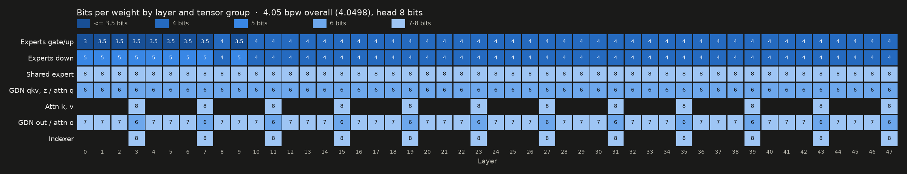

# Qwen3.8-Flash-Next self-calibrated EXL3

Code, recipe and notes behind the self-calibrated EXL3 4.05 bpw quant of
[Qwen/Qwen3.8-Flash-Next](https://huggingface.co/Qwen/Qwen3.8-Flash-Next):
[Vemloir/Qwen3.8-Flash-Next-sc-exl3](https://huggingface.co/Vemloir/Qwen3.8-Flash-Next-sc-exl3) (branch
`4.05bpw_sc_h8_ng8`). On two evaluation traces with no overlap with calibration it is 15.1% and 17.2% closer to BF16 (KL
divergence) than turboderp's 4.05 bpw quant with the same model size in memory (the n-gram table, streamed from disk,
is 8-bit here against 6-bit there). The current version is calibrated on set 2 (`regen/`, 2.15M tokens); the first
one (set 1, ~1M tokens, the scripts below) is within noise of it.

Everything is public, so the quant can be reproduced end to end:

| | |
|---|---|
| Code (MIT) | this repository: data generation, quality checks, packing, bit allocation, conversion, evaluation, exllamav3 1.6.1 patches |
| Calibration data that went into the quant (ODbL-1.0) | 2.15M tokens: [agents](https://huggingface.co/datasets/Vemloir/Qwen3.8-Flash-Next-calib-agents), [chat](https://huggingface.co/datasets/Vemloir/Qwen3.8-Flash-Next-calib-chat), [multimodal](https://huggingface.co/datasets/Vemloir/Qwen3.8-Flash-Next-calib-multimodal) |
| All generated data (ODbL-1.0) | 5.0M tokens, a superset with the same quality checks: [Vemloir/Qwen3.8-Flash-Next-traces](https://huggingface.co/datasets/Vemloir/Qwen3.8-Flash-Next-traces) |
| Evaluation | [Vemloir/Qwen3.8-Flash-Next-evaluation](https://huggingface.co/datasets/Vemloir/Qwen3.8-Flash-Next-evaluation): traces and per-token results |
| The quant | [Vemloir/Qwen3.8-Flash-Next-sc-exl3](https://huggingface.co/Vemloir/Qwen3.8-Flash-Next-sc-exl3), branch `4.05bpw_sc_h8_ng8`, with `recipe.yaml` |

- [docs/EXPERIMENTS.md](docs/EXPERIMENTS.md): what was measured and decided, with numbers
- [docs/CALIBRATION.md](docs/CALIBRATION.md): how the calibration data was built and why
- [docs/bit_allocation.md](docs/bit_allocation.md): bits per layer and tensor group ([image](docs/bit_allocation.png))

## Requirements

- exllamav3 1.6.1 with the patches in `patches/exllamav3-1.6.1/` (`git am`): image rows in calibration, low-disk
  conversion, chunked calibration rows, affinity-weighted expert Hessians, a capture-only fast path for MoE layers,
  qbench extensions, a `sc_measure` fix. The quant itself runs on stock exllamav3 >= 1.6.1.
- TabbyAPI serving the model for trace generation; Docker for the agent harnesses; headless Chromium for the
  frontend screenshots.
- The BF16 checkpoint (~340 GB) and ~110 GB of free disk for the conversion.

Scripts assume this layout under `~/lm-inference`: `models/Qwen3.8-Flash-Next/{BF16,...}`, `sc-quant/` (this
repository), `exllamav3-1.6.1-sc/` (patched exllamav3), `tabbyAPI/`, `datasets/MiMo-V2.6-RL-oss/`.

## Upstream

The conversion changes that matter beyond this model are offered to exllamav3:

| Change | Patch here | Upstream |
|---|---|---|
| Affinity-weighted expert Hessians (`--moe_affinity_eps`; -3.6% KL divergence [-6.2%, -0.8%] in an isolated ablation on Gemma 4 26B A4B, ~40% longer conversion, [EXPERIMENTS.md section 11](docs/EXPERIMENTS.md#11-ablation-of-the-expert-hessian-scheme-exllamav3-pr-529)) and a capture-only fast path for MoE layers (1.5-1.6x faster capture, bit-identical Hessians) | 0003, 0007 | [#529](https://github.com/turboderp-org/exllamav3/pull/529), open |
| `sc_measure`: pass each row's `input_ids` to every forward (PLE layers) | 0004 | [#518](https://github.com/turboderp-org/exllamav3/pull/518), merged |
| MoE CPU offload: bounded host memory while loading the expert arena | (1.5.3) | [#429](https://github.com/turboderp-org/exllamav3/pull/429), merged |

The PR version of 0007 leaves out the opt-in TF32 Hessian accumulation (`EXL3_CAPTURE_TF32`), which the
published quant was converted with.

## Reproducing

1. **Chat traces**, per reasoning level: `trace/trace_chat.py` (driver for exllamav3 `sc_trace.py` with extra
   prompts), wrapped by `gen_mixed.sh`.
2. **Agent sessions**: `agent-env/select_tasks.py` picks MiMo tasks; `agent-env/run_agents.py` runs the Codex,
   OpenCode and pi harnesses in Docker against TabbyAPI through `agent-env/trace_proxy.py`, which sets the reasoning
   level per session and logs every request; `agent-env/build_rows.py` turns the logs into token rows
   (`agents_mixed.sh`, `gap_chain.sh`).
3. **Image rows**: `trace/gen_pages.py` (pages and screenshots), `trace/make_image_items.py`,
   `trace/trace_images.py` (`night_img.sh` runs the chain).
4. **Packing**: `pack_v2.py` builds the ~1M-token calibration file with the reasoning-level budgets;
   `split_calibration.py` splits it into the published datasets.
5. **Bit allocation**: `tools/split_grid.py` (per-layer expert error for every bit split),
   `tools/alloc_grid.py` (allocation under a budget), then the recipe `calib/recipe_v3.yaml`
   (`tools/bit_map.py` draws it).
6. **Conversion**: `convert_v3.sh` (BF16 source, recipe, calibration, `--moe_affinity_eps 0.1`, low-disk mode,
   checkpoints every 30 minutes; ~8 hours on an RTX 5070 Ti with 61 GB of RAM).
7. **Evaluation**: `nemotron_eval_trace.py` and `multilingual_eval_trace.py` build the independent traces;
   `eval/qbench_nemotron.yaml` and `eval/qbench_multilingual.yaml` run exllamav3 qbench against BF16;
   `tools/kld_results.py` turns the qbench cache into per-source results with bootstrap intervals and
   `tools/readme_charts.py` draws the model card charts.

Calibration set 2 (the current version) is generated, packed and converted with the scripts in `regen/`; see
[regen/README.md](regen/README.md).

Experiment tools in `tools/`: `moe_hessian_test.py` (affinity Hessian prototype), `layer_sens.py`, `head_bits_test.py`,
and others. The `night_*.sh` and `*_chain.sh` scripts are the job chains actually run during development; they
document the order of steps and the memory limits used (`capped.sh`).

## License

MIT for the code in this repository. The data is licensed separately (ODbL-1.0 for the calibration datasets); the
model weights follow the Qwen Community License 1.0.
